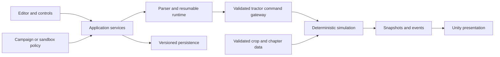

# Harvest Codex — game design and architecture

Status: researched design proposal; no playable implementation yet. Working title: Harvest Codex.

## Vision

A programming and farm automation game where players write small programs that control tractors. Players restore a farm, grow crops, fulfill contracts, and improve their algorithms. The reward is watching understandable code turn a modest field into an efficient farming operation.

Tractors are central to the mechanics: heading, turning space, interchangeable implements, fuel, cargo capacity, refueling, and unloading create planning problems. No drones. Use an original visual identity, writing, maps, economy, and missions.

Core loop: inspect a field → write a program → run or step it → watch tractor actions → inspect errors and production → refine the program → earn resources and unlock capabilities.

## Research and its limits

The developer's [Steam description](https://store.steampowered.com/app/2060160/The_Farmer_Was_Replaced/) confirms a Python-like language, farming resources used for technology unlocks, continuous progression, concepts introduced gradually, and editable `.py` program files with optional external file watching. These establish the gameplay pattern, not the internal implementation.

The developer says the reference game uses Unity in this [development discussion](https://www.reddit.com/r/pcmasterrace/comments/1neagcm/i_made_a_programming_farming_game_its_finally/). Its proprietary interpreter, scheduler, persistence model, and source architecture were not verified. The architecture below is our proposal; do not describe it as a reconstruction of that game's source.

Adaptation: keep the write-run-observe-optimize loop and gradual learning. Add a structured campaign, tractor logistics, and an immediately available sandbox. A small bounded scripting language and a deterministic simulation are proposed engineering choices.

## Game modes

### Campaign

One persistent farm develops through chapters and optional contracts. Each chapter teaches one concept with runnable examples, an API reference, clear objectives, and optional hints. Grant each chapter its teaching syntax and APIs on entry; completing its objectives unlocks the next chapter; spend farm resources on equipment and land. Teach before testing. Failure never deletes a player's scripts or permanently blocks progression.

| Chapter | Programming unlock | Farming challenge | Completion example |
| --- | --- | --- | --- |
| First harvest | Sequential commands, literals | One tractor, starter field, harvest implement | Harvest and unload the starter crop |
| Working rows | Variables and counted loops | Turning and repeatable row traversal | Harvest three rows without leaving the field |
| Read the field | Conditions and sensors | Ripeness, soil and mixed crops | Harvest only ripe plants |
| Reusable routines | Functions and local scope | Tilling, sowing, watering | Complete a crop cycle with reusable routines |
| Plan the harvest | Lists and bounded iteration | Cargo, fuel and route planning | Complete a contract while respecting capacities |
| Build the fleet | Tractor assignment and cooperative tasks | Multiple tractors, shared lanes and implements | Coordinate two tractors without conflicts |
| Master the farm | All supported language features | Larger maps and efficiency contracts | Meet a yield target within a displayed fuel budget |

Chapter targets and costs are content data, tuned through playtesting. Campaign completion opens continued free play. Optional efficiency medals reward better solutions without making optimization mandatory for the first successful solution.

### Sandbox

Available from the main menu immediately. All supported syntax, APIs, equipment, tractors and crop types are unlocked from the start. Offer map size, seed, starting resources, tractor count, growth speed, and optional unlimited fuel/resources. Unlimited resources do not imply unlimited execution or memory.

Separate saves and achievement eligibility prevent sandbox settings from changing campaign progress. Both modes use the same simulation and runtime; a mode policy supplies unlocks, objectives, economy settings and achievement eligibility. Show configured modifiers clearly. Sandbox has no compulsory campaign objectives.

## Player experience

Main view: farm viewport, script editor, run/pause/stop/step controls, selected tractor inspector, objective panel and bounded event console. Show active source lines and actionable errors with line and column information. A separate tutorial/reference panel explains APIs and unlocked concepts. Pause freezes simulation time. Step advances exactly one simulation tick while paused, including bounded interpreter work, active actions and crop growth. Stop cancels programs and pending actions at a defined tick boundary while retaining the farm state. Reset restores an explicit starting checkpoint after confirmation.

Use a readable 2D top-down field with tractor animations. Animation presents simulation results; it never determines crop state or action outcomes. Keyboard navigation, scalable text, non-color error cues, and adjustable animation speed are baseline requirements.

## Proposed technology decision

Desktop-first prototype: Unity with C# and an independently testable C# simulation/runtime library. This aligns with the confirmed reference engine, but is a proposal for this project rather than a requirement inferred from its gameplay. Chief must record the chosen supported engine/editor version, dependency lock state and target platforms before implementation. Start with macOS and Windows; verify platform builds before promising support.

Do not execute player programs as native Python, C#, JavaScript, shell commands or Unity reflection calls. Build a deliberately small Python-like language with an explicit grammar, AST validation and resumable interpreter. Advertise its supported subset precisely, rather than promising Python compatibility.

## Module boundaries



| Module | Owns | Must not own |
| --- | --- | --- |
| Domain/simulation | Fields, crops, tractors, actions, tick clock, deterministic RNG | Unity objects, editor widgets, disk access |
| Language/runtime | Tokens, syntax tree, lexical scopes, resumable execution, diagnostics, budgets | World mutation, host filesystem, network |
| Tractor API gateway | Capability checks, command validation, command results | Rendering or parsing source text |
| Application | Sessions, run controls, mode policy, objective evaluation, save coordination | Crop growth rules copied from domain |
| Content | Crop definitions, chapter graph, equipment, balance data | Executable scripts or hidden rule overrides |
| Presentation | Views, input, audio, animation and editor integration | Authoritative simulation state |
| Persistence | Save schemas, validation, migrations, atomic replacement | UI rendering or interpreting player programs |

Dependencies point toward domain contracts. Use narrow interfaces at external boundaries and explicit data types. Avoid a global manager that owns every system or a framework abstraction for every class.

Suggested repository layout:

```text
src/Harvest.Domain/
src/Harvest.Language/
src/Harvest.Application/
src/Harvest.Persistence/
game/Assets/Harvest/Presentation/
game/Assets/Harvest/Content/
tests/Domain/
tests/Language/
tests/Application/
tests/Persistence/
docs/decisions/
```

The Unity project references the core libraries through a documented build/import process; never maintain duplicate copies of the source. Establish assembly boundaries and compatibility in the initial technical spike.

## Simulation and tractor rules

World state includes bounded grid coordinates, soil and moisture, crop growth, obstacles, depot stock, tractors, equipment, cargo, fuel, and pending actions. Boundaries do not wrap. Each tractor starts as a one-tile vehicle with a heading and implement; turning and moving consume defined time and fuel. Larger footprints are a later feature.

Each simulation tick advances eligible script continuations with bounded instruction budgets, validates proposed actions, arbitrates shared cells, advances active actions and growth, and publishes events. Define this ordering in tests before adding content. Rates are integer or fixed-point simulation values, independent of frame rate. Seeded randomness and ordered entity IDs make replays reproducible.

An action records actor, target, start tick, duration and reserved cost. Validate and reserve fuel/materials at acceptance; apply results once at completion. Cancellation refunds only documented unused costs. Reject insufficient fuel, full cargo, incorrect implement, immature crops and blocked movement with structured results. Never silently teleport a tractor or discard cargo.

Multiple tractors execute cooperatively through one scheduler. A deterministic round-robin cursor, with stable IDs as tie-breakers, resolves same-tick cell contention; movement reservations prevent overlapping occupancy and head-on swaps. Static obstacles return an immediate `blocked` result. Occupied cells return `occupied` unless an explicitly requested queued move waits for a reservation. Queued moves reserve fuel only when accepted, and yield so another tractor can proceed. Detect prolonged waiting and report the actors and blocked cells; explicit rerouting belongs in player code or a documented navigation API.

## Language and API contract

Initial syntax: numeric/string/boolean literals, assignment, arithmetic, comparisons, `if`, counted `for`, bounded-by-runtime `while`, function definitions/calls, lists, the `range` builtin, boolean operators including `not`, and field access on immutable API result records. No classes, arbitrary imports, reflection or host code evaluation. Lock syntax nodes and APIs in campaign at validation time and again at command execution. Sandbox grants every supported capability.

Proposed API: `move_forward()`, `turn_left()`, `turn_right()`, `till()`, `sow(crop)`, `water()`, `harvest()`, `unload()`, `refuel()`, `attach(implement)`, `sense()`, `position()`, `fuel()`, `cargo()`, `wait(ticks)`, and `log(value)`. Depot actions require a valid depot location. Sensors return documented immutable values. Action calls yield until a result is available; failed actions return a result with `ok` and a reason code. Script type/syntax errors stop the offending program with a diagnostic.

Fleet APIs are a later milestone: assign one program per tractor through application services, expose controlled task coordination, and define isolation rather than sharing arbitrary mutable interpreter state.

```python
# Illustrative proposed syntax; assumes a harvest implement and three ripe tiles.
for tile in range(3):
    if sense().ripe:
        result = harvest()
        if not result.ok:
            log(result.reason)
    if tile < 2:
        move_forward()
```

The interpreter yields after a maximum number of instructions per tick, including loops that perform no farm action. Cap program size, AST depth, call depth, values/list allocation, log size and active programs. Values are copied or referenced through explicit language semantics, never host objects. Stop/pause remains responsive even for `while True` with no action. Limits are visible, consistent across modes, and tested with adversarial scripts.

## Persistence

Versioned saves include mode, seed, current RNG state, scheduler cursor, tick, world, campaign unlocks/objectives, sandbox modifiers, scripts and editor preferences. First release saving performs Stop at a safe tick boundary, cancels pending actions with documented refund rules, clears execution continuations and reservations, and persists only the stopped session; loading restores world state and scripts with execution stopped. Do not imply that serialized native call stacks can resume.

Write a validated temporary file, flush it, then atomically replace the destination with a recoverable previous save. Check schema version, sizes, coordinates, entity IDs and references on load. Report corrupt saves with recovery options. Cover migration and interrupted-write recovery. External script editing is optional after the core loop works; restrict paths to the selected program directory and validate changed files before running them.

## Delivery plan and acceptance gates

1. Technical spike: engine setup, isolated core assemblies, deterministic grid, bounded interpreter and one visible tractor. Verify a program can harvest, pause, step, stop and report a source error.
2. Vertical slice: one crop cycle, cargo/fuel/depot, working editor, first two campaign chapters and sandbox with all currently supported features unlocked. Verify cold-start play and save/load on both target platforms.
3. Campaign: conditions, routines, content validation, single-tractor chapters and progression economy; defer fleet-dependent chapters until the next milestone. Verify every chapter is reachable and its examples use only available features.
4. Fleet: two tractors, collision reservations, fair scheduling and waiting diagnostics. Complete fleet-dependent campaign chapters. Verify deterministic contention, fairness and cancellation.
5. Polish: accessibility, onboarding, performance profiling, migration/recovery, packaging and platform smoke checks.

Meaningful tests cover crop transitions, resource accounting, determinism, parser/runtime diagnostics, budget exhaustion, capability gating, action cancellation, save recovery, campaign reachability and sandbox isolation. A replay with the same seed, inputs and version must produce the same state hash. Profile the intended largest map and fleet before locking numeric performance goals. Do not claim checks passed before an implementation exists.

## Chief and five visible Paneflow panes

Target five panes total, including Chief. A visible pane must host a real agent session; internal subagents are not a substitute for visible Paneflow panes.

| Pane | Role | Branch example | Ownership |
| --- | --- | --- | --- |
| Chief | Orchestrates, defines interfaces, delegates, integrates approved changes | `integration/current` | Task ledger, architecture, integration |
| Simulation | Builds tractor and crop simulation | `feat/simulation-slice` | Domain and its tests |
| Runtime | Builds safe language and tractor API integration | `feat/runtime-slice` | Language and its tests |
| Experience | Builds editor, campaign, sandbox and persistence | `feat/experience-slice` | Presentation/application/content/persistence |
| Reviewer | Independently reviews and verifies exact candidate commits | `review/current` | Findings and acceptance evidence |

Chief assigns tasks with objective, owned paths, interface contract, dependencies, acceptance checks and base commit. Workers stay within their assigned worktree, commit small coherent changes, and report commit SHA, checks run and unresolved risks. Shared contract changes require coordination before edits. Add agents only when work warrants them and visible capacity is available; keep a dedicated independent reviewer.

Every role has its own Git worktree and branch. Chief's integration worktree is distinct from the main checkout. Reviewer tests candidates in its own worktree and does not repair code it is independently approving. Fixes go back to the owner, then undergo a new review. Only Chief updates main after reviewer approval and checks on the exact integrated tree.

### Atomic commits and integration

Each commit has one purpose, includes related tests/docs, builds at its intended integration point, and excludes generated output, credentials and unrelated formatting. Use explicit paths for staging. Examples: `feat(domain): add tractor movement reservations`, `test(runtime): cover instruction budget exhaustion`, `docs: define campaign unlock policy`.

Fetch the configured remote before branching or integrating. Never invent a remote URL. Create branches from an identified base commit, with separate worktrees under an ignored local directory. A task branch may contain several atomic commits; avoid a mixed catch-all commit.

Integration sequence: worker commits → Chief assembles a candidate branch → Reviewer reviews the candidate SHA and executes relevant checks → owners fix findings → Reviewer rechecks the new SHA → Chief fast-forwards main to the exact approved candidate SHA → verify main → push normally to the configured remote. Follow remote protections and PR requirements when present. No force push, destructive reset, bypassed review, or simultaneous worker edits on main. A conflict resolution or newly created merge commit changes the candidate and requires renewed review before main advances.

### Maintainable and safe implementation

Keep domain rules centralized and module dependencies explicit. Use named types, small cohesive units and structured errors. Reject quick fixes that bypass validation, hard-code tutorial outcomes, swallow failures, duplicate simulation logic, use global mutable state, or execute player code through a host evaluator. Make the narrowest complete change; avoid both spaghetti code and unnecessary architecture. Reviewer checks behavior, security boundaries, clarity, dependency direction and regression coverage.

### Paneflow operation and current setup limits

Paneflow exposes discovery/read/search and approval-gated agent messaging through MCP. Pane creation requires the local CLI or app. The [Paneflow documentation](https://github.com/arthjean/paneflow/blob/main/docs/user/conductor.md) describes declarative workspaces and orchestration. Verify the installed version's schema before preparing a workspace specification. After launch, Chief verifies all five surface IDs, names and working directories; it must not claim panes are open until discovery confirms them. Authorize agent pairs in Paneflow when its messaging gate requires it.

At document creation, this workspace had one Codex pane. The CLI could not reach the local host because the sandbox denied socket access. Git initialization also failed because writing `.git` is prohibited by the current filesystem policy. Consequently no Git commits, branches, worktrees, remote configuration or five-pane fleet have been created. The remote URL remains unspecified. This document is saved locally; those operational setup steps remain pending access and remote information. Implementation is future work, not an implied completed game.

Setup update (2026-10-11): GitHub OAuth now verifies the private repository `EvanGUTK/Harvest-Codex`, with clone URL `https://github.com/EvanGUTK/Harvest-Codex.git` and default branch `main`. Paneflow discovery shows eight Codex surfaces total (Chief plus seven additional panes), all currently using the same project directory. Separate worktrees and role assignments are still pending; pane presence alone does not establish independent task execution. The local project is still not a Git repository, and the current filesystem policy still prohibits writing `.git`.
